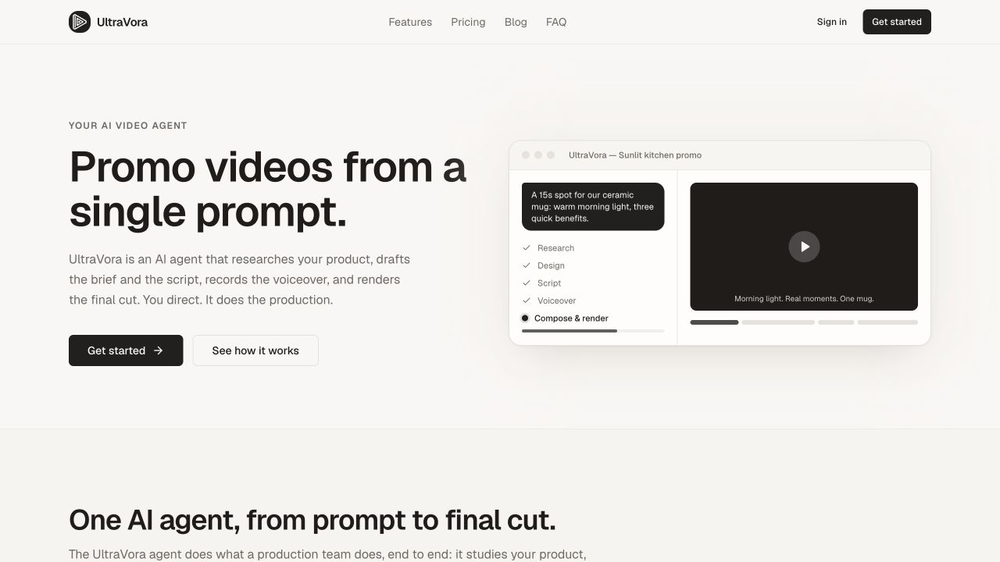

<div align="center">

# UltraVora

**From a product idea to a finished promo video.**

A self-hostable AI video studio that researches your product, writes the script, creates visuals and voiceover, and renders the final cut.

[简体中文](README.zh-CN.md) · [Quick start](#quick-start) · [Self-hosting](docs/deploy/gcp-production.md) · [Contributing](#contributing)

</div>



## What you can do

- **Direct the whole production.** Review research, script, design and voiceover before rendering, or turn on automatic approval.
- **Create product videos with AI.** Generate imagery, narration and background music, with subtitles and multiple aspect ratios.
- **Refine through conversation.** Follow live progress, revise intermediate artifacts and resume interrupted sessions.
- **Own the workspace.** Run the app yourself, keep media locally or archive it to your GCS bucket, and share selected videos in the public gallery.

```text
Product brief → Research → Script → Design → Voiceover → Compose → Render
```

Built with Next.js, React, Fastify, PostgreSQL, Pi agents, Gemini and HyperFrames.

## Quick start

Requires **Node.js 22+**, **pnpm 10**, **PostgreSQL**, and **FFmpeg**. Rendering also needs Chromium and system fonts; the HyperFrames doctor checks your setup. Supply your own Google OAuth credentials, Gemini API key, and Resend key with a verified sender domain. Provider usage is billed to your own accounts.

```bash
git clone git@github.com:AIchovy/UltraVora.git
cd UltraVora
pnpm install --frozen-lockfile
cp apps/server/.env.example apps/server/.env
cp apps/web/.env.local.example apps/web/.env.local
createdb ultracreator
openssl rand -base64 32
pnpm -F @ultracreator/server exec hyperframes doctor
```

Edit `apps/server/.env`: set `DATABASE_URL`, paste the generated value into `BETTER_AUTH_SECRET`, and fill in `GOOGLE_CLIENT_ID`, `GOOGLE_CLIENT_SECRET`, `GEMINI_API_KEY`, `RESEND_API_KEY` and `EMAIL_FROM`. Register `http://localhost:3000/api/auth/callback/google` as your OAuth callback.

For local development, set `BILLING_STUBS=1` to enable test credit top-ups. Keep it at `0` on any shared deployment. Real payments remain disabled unless you supply the full Creem configuration.

Start these in two terminals:

```bash
pnpm dev:server
pnpm dev:web
```

Open [localhost:3000](http://localhost:3000). The API listens on port 3001 and applies database migrations on startup. Sign up, create a video project, and use the local test top-up if you need more credits.

Gemini powers media generation even when you choose Anthropic or OpenRouter for the text model. Optional storage, model overrides and payment settings are documented in the [environment example](apps/server/.env.example). Voice audition clips require your own files or bucket; see [self-hosting](docs/deploy/gcp-production.md).

## Project structure

```text
apps/web         Next.js studio, preview and public gallery
apps/server      Fastify API, agents, media providers and render pipeline
packages/shared  Shared schemas and types
email-templates  Verification email templates
```

## Development

```bash
pnpm typecheck
pnpm test --project unit
pnpm -F @ultracreator/web build
```

PostgreSQL integration tests require a separate, disposable database and reset its public schema. External tests call real providers and need credentials. Run one API instance with persistent workspace storage; see [deployment notes](docs/deploy/gcp-production.md).

## Contributing

Issues and pull requests are welcome. For larger changes, open an issue first to discuss the approach. Include reproduction steps or a short demo and the checks you ran. Never commit environment files, private keys or generated session data.

## License

Original UltraVora code is licensed under [MIT](LICENSE). Bundled third-party skills, templates and dependencies retain their own terms; see [third-party notices](THIRD_PARTY_NOTICES.md).
