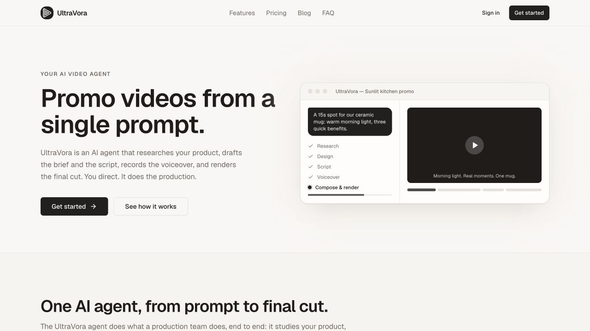

<div align="center">

# UltraVora

**从产品想法，到完整宣传视频。**

可自行部署的 AI 视频工作台，自动完成产品调研、脚本、视觉设计、配音和最终渲染。

[English](README.md) · [快速开始](#快速开始) · [部署指南](docs/deploy/gcp-production.md) · [参与贡献](#参与贡献)

</div>



## 能做什么

- **掌控制作过程。** 逐步审核调研、脚本、设计和配音，也可以开启自动审批。
- **用 AI 制作产品视频。** 生成图片、旁白与背景音乐，支持字幕和多种画面比例。
- **通过对话调整。** 实时查看进度，修改中间产物，恢复中断的任务。
- **自行部署和管理。** 媒体保存在本地或归档至自己的 GCS 存储桶，选定的视频可以发布到公共作品广场。

```text
产品需求 → 调研 → 脚本 → 设计 → 配音 → 合成 → 渲染
```

基于 Next.js、React、Fastify、PostgreSQL、Pi agents、Gemini 和 HyperFrames 构建。

## 快速开始

需要 **Node.js 22+**、**pnpm 10**、**PostgreSQL** 和 **FFmpeg**。渲染还需要 Chromium 与系统字体，可用 HyperFrames doctor 检查。请准备自己的 Google OAuth 凭据、Gemini API Key，以及 Resend API Key 和已验证的发件域名。外部服务费用由各自账号承担。

```bash
git clone git@github.com:AIchovy/UltraVora.git
cd UltraVora
pnpm install --frozen-lockfile
cp apps/server/.env.example apps/server/.env
cp apps/web/.env.local.example apps/web/.env.local
createdb ultracreator
openssl rand -base64 32
pnpm -F @ultracreator/server exec hyperframes doctor
```

编辑 `apps/server/.env`：配置 `DATABASE_URL`，将刚生成的随机值填入 `BETTER_AUTH_SECRET`，再填写 `GOOGLE_CLIENT_ID`、`GOOGLE_CLIENT_SECRET`、`GEMINI_API_KEY`、`RESEND_API_KEY` 和 `EMAIL_FROM`。Google OAuth 回调地址设为 `http://localhost:3000/api/auth/callback/google`。

本地开发可设置 `BILLING_STUBS=1`，启用测试积分充值。对外部署时保持 `0`。未填写完整的 Creem 配置时，真实支付不会启用。

在两个终端中分别启动：

```bash
pnpm dev:server
pnpm dev:web
```

打开 [localhost:3000](http://localhost:3000)。API 监听 3001 端口，启动时自动执行数据库迁移。注册账号后即可创建视频项目，积分不足时可使用本地测试充值。

即使文本模型选择 Anthropic 或 OpenRouter，媒体生成仍使用 Gemini。存储、模型覆盖与支付等可选配置见[环境变量示例](apps/server/.env.example)。语音试听需要提供自己的音频文件或存储桶，详见[部署指南](docs/deploy/gcp-production.md)。

## 项目结构

```text
apps/web         Next.js 工作台、预览和公共作品广场
apps/server      Fastify API、智能体、媒体服务和渲染流水线
packages/shared  共享数据结构和类型
email-templates  验证邮件模板
```

## 本地开发

```bash
pnpm typecheck
pnpm test --project unit
pnpm -F @ultracreator/web build
```

PostgreSQL 集成测试需要独立的临时数据库，会重建其 public schema。外部测试会调用真实服务，需要额外配置凭据。API 请以单实例运行，并持久化保存工作目录，详见[部署说明](docs/deploy/gcp-production.md)。

## 参与贡献

欢迎提交 Issue 和 Pull Request。较大的改动请先发 Issue 讨论，提交时附上复现步骤或简短演示，以及执行过的检查。请勿提交环境文件、私钥或生成的会话数据。

## 许可证

UltraVora 原创代码采用 [MIT 许可证](LICENSE)。随附的第三方技能、模板和依赖保留各自的许可条款，详见[第三方声明](THIRD_PARTY_NOTICES.md)。
